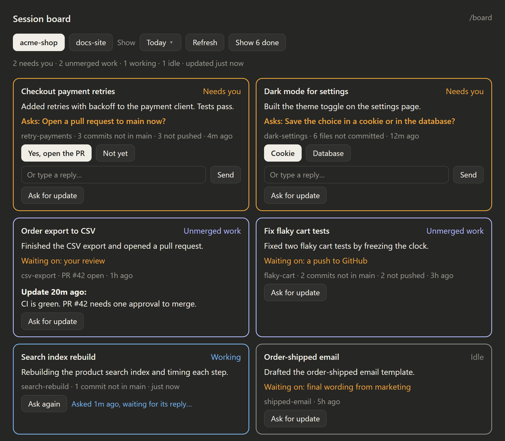

# Session Board: an ADHD-friendly manager view for Claude Code

A Claude Code mod for people who run several Claude sessions on one project.
It opens a panel beside the chat with one card per session, so you can manage
them like a small team.

Running ten sessions at once? The board shows which ones need you, which have
work that is not merged, and what each one is waiting on. You can answer a
session's question from its card.



<sub>An illustration with made-up sessions. The real pane uses the desktop app's own styling.</sub>

Each card shows:

- the session's title and status: **Needs you**, **Unmerged work**, **Working** or **Idle**
- what the session is doing, in one line
- what it is waiting on (CI, a review, a merge, your decision)
- its branch, its pull request, and any work not yet merged: files not committed,
  commits not in the base branch, commits not pushed
- when the session asked you something: the question, with one-click answers
  and a box to type your own reply
- an **Ask for update** button that messages the session and asks for its
  status. The reply shows on the card, not in your chat.

Cards are sorted so the sessions that need you come first. Finished sessions
(merged PR and a clean worktree, or idle for 7 days) are hidden behind
**Show N done**.

The **Show** list picks how far back to look: Today (the default), Since
yesterday, any of the last 7 days, or All dates. A session that is working
right now always shows.

## Requirements

- The **Claude desktop app** (Code tab). The board reads your sessions through
  the app's own session tools, so it does not work in a plain terminal session.
- `git` on your `PATH`.

## Install

At the prompt of a terminal Claude Code session:

```
/plugin install session-board --marketplace Avavaziri/claude-code-adhd-session-board
```

Answer `y` to add the marketplace, then pick the user scope.

From a shell:

```bash
claude plugin install session-board --marketplace Avavaziri/claude-code-adhd-session-board
```

In the desktop app: click **+** next to the prompt box, then **Plugins**,
**Add marketplace**, enter `Avavaziri/claude-code-adhd-session-board`, then **Add plugin**.

### Run it from a local folder instead

1. Clone this repository somewhere outside OneDrive or Dropbox.
2. Open `~/.claude/settings.json`.
3. Add the folder under `env`:

   ```json
   {
     "env": {
       "CLAUDE_CODE_PLUGIN_DIRS": "C:\\path\\to\\session-board"
     }
   }
   ```

4. To reload the board when its files change, also add
   `"CLAUDE_CODE_PLUGIN_DIR_WATCH": "1"` under `env`.
5. Start a new session. Sessions already open do not pick it up.

## Use

- The board opens by itself when a session starts. Type `/board` to open it again.
- The **Project** list picks which project to show. The board remembers your choice.
- It refreshes every minute. **Refresh** forces an update now.

## How it works

- Sessions come from the desktop app's session list. A session belongs to a
  project when its folder is the project folder or a worktree under
  `<project>/.claude/worktrees/`.
- Unmerged work comes from `git` in each session's worktree. The base branch is
  the branch the main project folder is on.
- The "doing" and "waiting on" lines come from a short Claude Haiku call over
  the end of each session's transcript. A session is summarised again only when
  it changes, so the cost stays small.

## Develop

```bash
claude plugin validate .
claude plugin test .
```

## Licence

MIT
